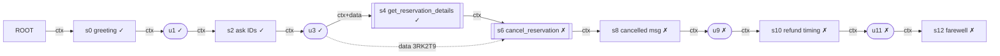

# Task 48: NLI probe and first MCS mappings (failure vs success)

Initial results for review **before** any full-task consensus scoring. Every number below was produced by actually
running `microsoft/deberta-large-mnli` (snapshot `7296194b9009373def4f7c5dad292651e4b5cf4e`, MPS, fp32,
torch 2.14.1, transformers 5.21.0). Method provenance ([PDF] / [CODE] / [OURS]) is in `gibs/mcs/README.md`.

| File | Content |
|---|---|
| `nli_probe.json` | 16 real text pairs, pre-registered expectations, both directions, both encodings, CPU check |
| `nli_probe_posthoc_compact.json` | post-hoc diagnostic (not pre-registered): 4 long pairs re-rendered as compact JSON |
| `step_graph_task48_*.json` | schema v0.2 graphs (`7f5cbcd7` failure, `c890f90b` success, `655b2a43` control success) |
| `projection_{event_context,paper_literal}_*.json` | projected operation/result graphs used by MCS |
| `mcs_task48_pair.json` | MCS results for every configuration (mappings, all candidates, scores, truncation flags) |
| `mcs_failure_vs_success_primary.mmd`, `mcs_success_vs_success_control.mmd` | query graphs coloured by mapping |

The v0.1 example in `gibs/examples/task48_success/` is unchanged (pinned by hash in the tests).

## 1. NLI probe (16 real pairs, τ = 0.7)

`a` = failed-run text (query), `b` = passing-run text (reference). Expectations were fixed before the run.
`max` is the primary similarity ([CODE] max of both directions); `one-way` is P(a ⇒ b).

| ID | Category | Expect | P(a⇒b) | P(b⇒a) | max | max OK? | one-way OK? | Tokens |
|---|---|---|---|---|---|---|---|---|
| P01 | identical tool call | high | 0.984 | 0.984 | 0.984 | ✓ | ✓ | 42 |
| P02 | identical message | high | 0.991 | 0.991 | 0.991 | ✓ | ✓ | 22 |
| P03 | same tool, different DOB (T40) | low | 0.208 | 0.457 | 0.457 | ✓ | ✓ | 178 |
| P04 | same tool, different date + flight (T25) | low | 0.779 | 0.831 | 0.831 | **✗** | **✗** | 518 · truncated |
| P05 | cancel vs lookup, same argument | low | 0.000 | 0.000 | 0.000 | ✓ | ✓ | 40 |
| P06 | identical observation | high | 0.978 | 0.978 | 0.978 | ✓ | ✓ | 584 · truncated |
| P07 | cancel observation vs lookup observation | low | 0.972 | 0.978 | 0.978 | **✗** | **✗** | 613 · truncated |
| P08 | update observation, different DOB (T40) | low | 0.959 | 0.974 | 0.974 | **✗** | **✗** | 584 · truncated |
| P09 | user gives same IDs (paraphrase) | high | 0.995 | 0.205 | 0.995 | ✓ | ✓ | 102 |
| P10 | user: thanks-for-cancelling vs appeal | low | 0.006 | 0.009 | 0.009 | ✓ | ✓ | 146 |
| P11 | user: same instruction, different wording (T34) | high | 0.114 | 0.000 | 0.114 | **✗** | **✗** | 60 |
| P12 | user: "proceed with all changes" vs "do not proceed" (T34) | low | 0.000 | 0.000 | 0.000 | ✓ | ✓ | 51 |
| P13 | agent asks for IDs (paraphrase) | high | 0.037 | 0.995 | 0.995 | ✓ | **✗** | 128 |
| P14 | agent: "cancelled" vs "cannot cancel" | low | 0.000 | 0.000 | 0.000 | ✓ | ✓ | 178 |
| P15 | agent: 6 vs 4 suitcases (T3) | low | 0.002 | 0.000 | 0.002 | ✓ | ✓ | 25 |
| P16 | agent: farewell vs transfer notice | low | 0.016 | 0.001 | 0.016 | ✓ | ✓ | 43 |

As expected: **max 12/16** (11/12 for pairs within 512 tokens), **one-way 11/16**.

Other measurements:
* **Encoding.** The [CODE] string `a [SEP] b` never produced the same token IDs as tokenizer pair encoding
  (0/16); |Δ max| ≤ 0.029 for untruncated pairs and 0.093 for P04.
* **Device.** CPU vs MPS on P01–P06: max |Δ| = 1.7 × 10⁻⁶.
* **Speed.** Model load 2.9 s; the 32 uncached directional scores took 6.9 s (MPS).

**Post-hoc diagnostic** (not pre-registered). The four long pairs were re-rendered as compact JSON, which fits
in 512 tokens without truncation:

| ID | Flattened text (above) | Compact JSON, untruncated |
|---|---|---|
| P04 date + flight differ | 0.831 ✗ | **0.323 ✓** |
| P06 identical observation | 0.978 ✓ | 0.981 ✓ |
| P07 cancelled vs active reservation | 0.978 ✗ | **0.968 ✗** |
| P08 different DOB in observation | 0.974 ✗ | **0.972 ✗** |

Conclusions:
1. **Text rendering is consequential** (P04).
2. **DeBERTa-MNLI does not separate long JSON observations that differ in one decision-relevant field, even
   without truncation** (P07, P08). In MCS, a tool step's result-node threshold will not distinguish such
   observations; the operation text (P05: cancel vs lookup = 0.000) and the mapping constraints must.
3. Bidirectional max is needed for paraphrases that add detail (P09, P13); one-way fails P13.
4. A same-intent user instruction worded differently (P11) is **not** matched, which will lower consensus
   for steps that follow such turns under the context topology.

## 2. MCS: failure `7f5cbcd7` (query) vs success `c890f90b` (reference)

Primary configuration: [CODE] max-bidirectional NLI, event-context topology, R3 source+target thresholds,
R4 all-candidate pool, R5 size = edges + nodes, `require_same_kind`.
**Result: size 11, 5 of 13 query edges mapped, 5 candidate pairs, seed `N:s2→N:u3`.**

| Query step | Kind | Operation (abridged) | Mapped to | m_node pair indicator ([PDF]) | m_ctx pair indicator ([OURS]) |
|---|---|---|---|---|---|
| s0 | agent message | "Hi! How can I help you today?" | N:s0 | 1 | 1 |
| s2 | agent message | asks for user ID and reservation ID | N:s2 | 1 | 1 |
| s4 | tool call | `get_reservation_details(3RK2T9)` | N:s4 | 1 | 1 |
| **s6** | tool call | **`cancel_reservation(3RK2T9)`** | — | **0** | **0** |
| s8 | agent message | "cancelled successfully … full refund" | — | 0 | 0 |
| s10 | agent message | refund timing | — | 0 | 0 |
| s12 | agent message | farewell | — | 0 | 0 |

Mapped edges, with scores:
- `ROOT→s0`: e 0.991, src 1.000, tgt 0.991
- `s0→u1`: 0.992 / 0.991 / 0.992
- `u1→s2`: 0.995 / 0.992 / 0.995
- `s2→u3`: 0.995 / 0.995 / 0.995
- `u3→s4`: 0.984 / 0.995 / 0.978 — **the target similarity used truncated text** (lookup observations, 584 tokens)

Why s6–s12 are unmapped: their operation text reaches at most **0.094 / 0.089 / 0.243 / 0.339** against *every*
reference edge, all below τe. The first unsupported agent step is the prohibited `cancel_reservation`. This is
consistent with the DB-mismatch outcome of this run, but it is **not** a correctness label.

(Full graph with texts: `mcs_failure_vs_success_primary.mmd`.)

### Ablations on the same pair

| Configuration | Size | Mapped edges | Agent steps mapped |
|---|---|---|---|
| primary | 11 | 5/13 | s0, s2, s4 |
| one-way NLI | 5 | 2/13 | s0 only (s2 paraphrase fails one direction) |
| [CODE] expansion pool = top 10 | 11 | 5/13 | s0, s2, s4 (pool never binds here: only 5 candidates) |
| [CODE] source rule (target only) | 11 | 5/13 | s0, s2, s4 (no contradictory source in this pair) |
| paper-literal topology | 11 | 5/12 | s0, s2, s4 (seed `ROOT→u3`) |

## 3. Control: success `c890f90b` (query) vs another success `655b2a43`

| Configuration | Size | Mapped edges | Agent steps mapped | Unmapped agent steps |
|---|---|---|---|---|
| primary (event context) | 11 | 5/11 | s0, s2, s4 | s6 refusal, s8 transfer call, s10 transfer notice |
| paper-literal topology | 15 | 7/10 | s0, s2, s4, **s10** | s6, s8 |

Why the correct steps are unmapped:
* **s6 refusal message.** `655b2a43` took a different valid path: `get_user_details`, then a direct transfer,
  with no refusal message. There is no counterpart to match.
* **s8 transfer call.** The two `summary` arguments are worded differently, and the edge similarity is 0.28.
  The highest-scoring edge (0.945) was a *user-turn* edge, which `require_same_kind` correctly excluded.
* **s10 transfer notice.** Identical text (0.992), so it is a valid candidate. Under the context topology it is
  disconnected from the matched prefix, and the single-seed BFS keeps only the largest connected piece. The
  paper-literal topology attaches it to ROOT, so it is recovered.

**Implication:** under the event-context topology, consensus mostly reflects the *shared connected prefix*.
After the first divergence, even a valid alternative path, later correct steps get no support from that
reference. The paper-literal topology recovers some of them, but it has no context edges, so the stricter
`m_ctx` target then loses its protection against contradictory instructions (see `gibs/tests/test_consensus.py`).

## 4. Truncation

Only one text pair was truncated in the MCS runs: the identical lookup observations (target of `u3→s4`). In the
probe, 4/16 pairs exceeded 512 tokens. The [CODE] truncation policy is active, and every truncated comparison
is flagged in `mcs_task48_pair.json` (`truncated_text_used`).

## 5. Decisions needed before full-task consensus scoring

1. **Long tool texts.** Keep [CODE] truncation, or adopt a compact JSON rendering (P04 evidence), or something
   else? Compact JSON still exceeds 512 tokens for some search results (up to 2,180 tokens).
2. **Observation similarity.** NLI cannot separate near-duplicate JSON observations (P07, P08). Accept this as
   a known limitation, or add a non-NLI structural check for tool results? The latter would be a departure from
   the PDF.
3. **Topology.** Event-context (protects `m_ctx` against contradictions, but consensus ≈ shared prefix) vs
   paper-literal (recovers disconnected matches, but no context protection). Or report both.
4. **Paraphrased user instructions** (P11) are not matched at 0.7; this lowers `m_ctx` for the steps that
   follow them. Keep τ = 0.7 as in the [PDF]?
