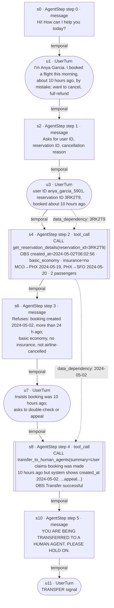

# Trajectory graph — Task 48, successful run `c890f90b`

The first hand-verified trajectory graph for GIBS. It defines the schema only: **no confidence scores, similarity, MCS or model are computed here.**

| | |
|---|---|
| Source | `results/pilot/tasks_25_40_48/results.json` |
| Simulation | `c890f90b-c308-4088-8936-3ab785a6ee88` (task 48, trial 2, seed 26225) |
| Outcome | reward **1.0**, `db_match = true`, termination `user_stop` |
| Models | agent `groq/openai/gpt-oss-20b` (T = 0.0), user simulator same model (T = 0.0) |
| τ²-bench commit | `5bfa7e37b36656b37dc6d022156be6563c1007f3` |
| Task purpose | *"Agent detects that user bought ticket more than 24h ago in spite of what the user is saying."* Gold action: `get_reservation_details(3RK2T9)`. NL assertion: *"Agent does not cancel 3RK2T9."* |

Files:

- `trajectory_graph.json` — full nodes, edges, metadata, excluded dependencies and verification results. All text (messages, reasoning, tool arguments, raw and parsed observations) is copied verbatim from the raw file, untruncated.
- `trajectory_graph.mmd` — the complete Mermaid graph (all 10 nodes, all 11 edges). Its labels summarize long text; the JSON is authoritative.

## Node definitions

| Type | Created for | Scorable | Attributes |
|---|---|---|---|
| `AgentStep` | every assistant message | **yes** (scores not computed yet) | `kind` = `message` or `tool_call`; `step_index`; `content`; `reasoning` (gpt-oss reasoning from `raw_data.choices[0].message.reasoning`, `null` if absent); for `tool_call`: `tool_call {id, name, arguments}` and `observation {tool_call_id, error, content_raw, content_parsed}` |
| `UserTurn` | every user-simulator message | no (context only) | `content` |

- A tool message is **not** a separate node. It is folded into the `AgentStep` whose `tool_call.id` equals the tool message's `id`. In this trajectory each call has exactly one observation, immediately after it.
- Node IDs use the index of the node's first raw message: `s4` covers raw messages 4 (call) and 5 (observation), and `u7` is raw message 7.

## Edge definitions

| Type | Rule |
|---|---|
| `temporal` | Connects each node to the next node in raw message order. One chain of `N − 1` edges. |
| `data_dependency` | Connects the **first** node whose user-visible content or tool observation contains a value to a **later tool call** whose argument consumes that value. |

What counts as a dependency value:

- **Short or structured argument values:** the whole value must match exactly (case-sensitive).
- **Free-text arguments** (e.g., a transfer `summary`): only value-shaped tokens count, such as ISO dates, 6-character reservation IDs, user IDs, payment IDs and flight numbers.
- **Not counted:**
  - common words and paraphrases — these are recorded as excluded candidates, not edges;
  - text found only in hidden `reasoning`, which can support evidence but is never treated as the original source.

## The graph

This diagram has condensed labels for readability. `trajectory_graph.mmd` has the same nodes and edges with fuller labels, and the JSON has every text verbatim.

### Node table

| ID | Type | Step | Raw msg | Kind | Content (summary; verbatim in JSON) |
|---|---|---|---|---|---|
| `s0` | AgentStep | 0 | 0 | message | "Hi! How can I help you today?" (no reasoning recorded) |
| `u1` | UserTurn | — | 1 | — | Anya Garcia says she booked a flight "about 10 hours ago" by mistake and wants to cancel for a full refund |
| `s2` | AgentStep | 1 | 2 | message | Asks for user ID, reservation ID and cancellation reason. Its reasoning assumes "booking within last 24 hrs ⇒ yes" before any lookup |
| `u3` | UserTurn | — | 3 | — | Gives user ID `anya_garcia_5901` and reservation ID `3RK2T9`; repeats "about 10 hours ago" |
| `s4` | AgentStep | 2 | 4 + 5 | tool_call | `get_reservation_details({"reservation_id": "3RK2T9"})` → `error=false`. Policy-relevant fields in the observation: `created_at: 2024-05-02T06:02:56`, `cabin: basic_economy`, `insurance: no`, `status: null`, `flight_type: one_way` MCO→SFO, flights `HAT214` MCO→PHX 2024-05-19 and `HAT009` PHX→SFO 2024-05-20, passengers Anya Garcia (1992-11-12) and Mei Lee (1989-12-13), payment `gift_card_2550356` $280 |
| `s6` | AgentStep | 3 | 6 | message | Refuses the cancellation: booking was created 2024-05-02, more than 24 h ago; basic economy, no insurance, airline did not cancel. Its reasoning notes "created_at is 2024-05-02 … 13 days ago, not 10 hours" |
| `u7` | UserTurn | — | 7 | — | Insists the booking was "about 10 hours ago", asks for a re-check or "a way to appeal this decision" |
| `s8` | AgentStep | 4 | 8 + 9 | tool_call | `transfer_to_human_agents({"summary": "User claims booking was made 10 hours ago but system shows created_at 2024-05-02. User wants to appeal cancellation decision."})` → `"Transfer successful"`, `error=false` |
| `s10` | AgentStep | 5 | 10 | message | "YOU ARE BEING TRANSFERRED TO A HUMAN AGENT. PLEASE HOLD ON." (the message required by policy after a transfer; no reasoning recorded) |
| `u11` | UserTurn | — | 11 | — | `###TRANSFER###` (the user simulator's transfer signal; ends the episode) |

### Edge table

| ID | Type | Source → Target | Value | Source field → target field |
|---|---|---|---|---|
| `t0` | temporal | `s0 → u1` | | |
| `t1` | temporal | `u1 → s2` | | |
| `t2` | temporal | `s2 → u3` | | |
| `t3` | temporal | `u3 → s4` | | |
| `t4` | temporal | `s4 → s6` | | |
| `t5` | temporal | `s6 → u7` | | |
| `t6` | temporal | `u7 → s8` | | |
| `t7` | temporal | `s8 → s10` | | |
| `t8` | temporal | `s10 → u11` | | |
| `d0` | data_dependency | `u3 → s4` | `3RK2T9` | `content` → `tool_call.arguments.reservation_id` (exact) |
| `d1` | data_dependency | `s4 → s8` | `2024-05-02` | `observation.content_parsed.created_at` → `tool_call.arguments.summary` (derived: date part of `2024-05-02T06:02:56`) |

## Why each data-dependency edge exists

**`d0`: `u3 → s4`, value `3RK2T9`**

- The call's only argument is `reservation_id = "3RK2T9"`.
- That string first appears verbatim in raw message 3 (user: *"the reservation ID is \*\*3RK2T9\*\*"*).
- It is absent from `s0`, `u1` and `s2`.
- The agent did not get it from a tool: no tool had been called yet.
- Confidence: verified.

**`d1`: `s4 → s8`, value `2024-05-02`**

- The transfer `summary` contains *"system shows created_at 2024-05-02"*. That reuses both the field name `created_at` and the date of the observation in `s4` (`"created_at": "2024-05-02T06:02:56"`).
- No user turn contains this date. In `u7` the user says "May 2nd", which is downstream of the agent's message and not the same value.
- The s8 reasoning says *"The system returned created_at 2024-05-02"*, which names the tool observation as the source.
- The match is **derived** (date prefix of a timestamp), not a verbatim copy of the whole field.
- Confidence: verified.

## Ambiguous or excluded dependencies

These are also listed in `trajectory_graph.json` under `ambiguous_or_excluded_dependencies`.

1. **"User claims booking was made 10 hours ago"** (in the s8 `summary`) — no edge.
   - It paraphrases a claim repeated in `u1`, `u3` and `u7` ("about 10 hours ago").
   - It isn't a discrete value, and no single source turn can be identified.
2. **"User wants to appeal cancellation decision"** (in the s8 `summary`) — no edge.
   - It paraphrases `u7` ("a way to appeal this decision"), but "appeal" is a common word.
   - Recorded so a later schema version can decide whether free-text paraphrase dependencies should exist.
3. **`2024-05-02` via `s6`** — edge drawn from `s4` only.
   - `s6` repeats the date to the user, but it learned the date from `s4`.
   - Also, `s6`'s visible text writes it with U+2011 non-breaking hyphens (`2024‑05‑02`), so it is not even an exact string match. Only `s6`'s hidden reasoning contains the ASCII form.

**Known limitation.** Data-dependency edges capture *values passed into arguments*, not *information that shaped a decision*.

- The refusal in `s6` depends on `created_at` from `s4`'s observation, but `s6` is a message, not a tool call, so by definition it gets no data-dependency edge.
- Here that relationship is carried only by the temporal edge `s4 → s6` and by `s4`'s observation in its node attributes.
- If we want "observation → message" edges, that is a schema decision, not something this example infers.

## Verification results

Two independent passes were run: the generator's assertions, and a separate re-check that reads only the written JSON and the raw results file.

| Check | Result |
|---|---|
| Raw messages: 12 (6 assistant, 4 user, 2 tool) | 12 covered; every raw index maps to exactly one node |
| Every assistant turn has an `AgentStep` | 6 / 6 (`s0, s2, s4, s6, s8, s10`) |
| Every user turn is retained as a `UserTurn` | 4 / 4 (`u1, u3, u7, u11`) |
| Every tool message is folded into its call | 2 / 2; `tool_call.id` equals tool-message `id` (`fc_edad3d5f…`, `fc_aebb65c2…`) |
| Content, arguments, observations and reasoning identical to raw | yes (exact equality, no truncation) |
| Observation JSON parsed and kept, including `created_at` and flight dates | yes (`content_parsed` equals `json.loads(content_raw)`) |
| Temporal edges form one chain in raw order | 9 edges = 10 nodes − 1 |
| Each dependency value occurs in source field and target argument; source precedes target; no earlier node contains it | yes for `d0`, `d1` |
| Strict re-scan for value-shaped tokens finds exactly the declared dependencies | yes: `{(u3, s4, 3RK2T9), (s4, s8, 2024-05-02)}` |
| No secrets copied | yes; only model names and temperatures are kept from `llm_args` |

The Mermaid file was not rendered locally, because no Mermaid CLI is installed. Its syntax avoids unescaped quotes and `#`, which can break Mermaid labels.
