# Paper GIBS: executed prototype demonstration

The PDF-style BERT/two-layer-GCN predictor scored a newly collected Task 20 trajectory.
Its checkpoint was trained on historical Groq data. This is a new-query inference demonstration, not fresh ASU retraining or proof of improved accuracy.

The query contains no reward or gold actions. No successful references were supplied at inference.
Changing external reward/gold fields reproduced exactly the same scores; see acceptance_checks.json.

| Step | Operation | Confidence score |
|---|---|---|
| s0 | Hi! How can I help you today? | 1.0000 |
| s2 | Could you please provide your user ID so I can look up your profile? | 0.8725 |
| s4 | Call get_user_details with user_id = mia_li_3668. | 0.5830 |
| s6 | Call search_direct_flight with origin = JFK; destination = SEA; date = 2024-05-20. | 0.0723 |
| s8 | Great news! I found two direct flights from JFK to SEA on May 20: 1. HAT083 - Departs 01:00, Arrives 07:00 - B | 0.0466 |
| s10 | Call search_onestop_flight with origin = JFK; destination = SEA; date = 2024-05-20. | 0.0845 |
| s12 | Here are the one-stop options (all via Atlanta/ATL) departing JFK after 11am EST: Option 1: - HAT136: JFK → AT | 0.0669 |
| s14 | Great! Before I proceed, I need a few more details: 1. Passenger(s): Who will be flying? Please provide the fi | 0.1423 |
| s16 | Thank you! Here's a summary of the booking for your confirmation: - Trip type: One-way - Route: JFK → SEA (via | 0.0451 |
| s18 | Call book_reservation with user_id = mia_li_3668; origin = JFK; destination = SEA; flight_type = one_way; cabi | 0.0774 |
| s20 | Your booking is confirmed! Here's the summary: - Reservation ID: HATHAT - Route: JFK → SEA (via ATL) - Date: 2 | 0.0287 |

Scores measure learned agreement with the training consensus; they are not established correctness probabilities.

The separate fresh experiment will recompute paper/C4 teachers, retrain both predictors, and compare against semantic NIBS and simple baselines after collection.

## Actual new query graph

```mermaid
flowchart TD
  v0["ROOT: ROOT"]
  v1["s0: Hi! How can I help you today?"]
  v2["u1: Hi, I'd like to book a one-way flight from New York to Seattle on May "]
  v3["s2: Could you please provide your user ID so I can look up your profile?"]
  v4["u3: Sure, my user ID is mia_li_3668."]
  v5["s4: Call get_user_details"]
  v6["s6: Call search_direct_flight"]
  v7["s8: Great news! I found two direct flights from JFK to SEA on May 20: 1. H"]
  v8["u9: I don't want to fly before 11am EST, so neither of those direct flight"]
  v9["s10: Call search_onestop_flight"]
  v10["s12: Here are the one-stop options (all via Atlanta/ATL) departing JFK afte"]
  v11["u13: I'd like to go with Option 1 in Economy."]
  v12["s14: Great! Before I proceed, I need a few more details: 1. Passenger(s): W"]
  v13["u15: The passenger is me, Mia Li. My birthday is in my user profile, so I d"]
  v14["s16: Thank you! Here's a summary of the booking for your confirmation: - Tr"]
  v15["u17: I'd like to use my two certificates to pay for this."]
  v16["s18: Call book_reservation"]
  v17["s20: Your booking is confirmed! Here's the summary: - Reservation ID: HATHA"]
  v18["u21: The user ended the conversation."]
  v0 -->|"root"| v1
  v0 -->|"root"| v2
  v0 -->|"root"| v3
  v0 -->|"root"| v4
  v4 -->|"data"| v5
  v0 -->|"root"| v6
  v0 -->|"root"| v7
  v0 -->|"root"| v8
  v6 -->|"data"| v9
  v0 -->|"root"| v10
  v0 -->|"root"| v11
  v0 -->|"root"| v12
  v0 -->|"root"| v13
  v0 -->|"root"| v14
  v0 -->|"root"| v15
  v4 -->|"data"| v16
  v6 -->|"data"| v16
  v9 -->|"data"| v16
  v5 -->|"data"| v16
  v0 -->|"root"| v17
  v0 -->|"root"| v18
```

